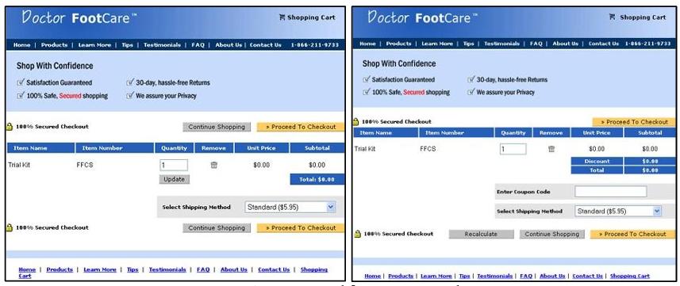
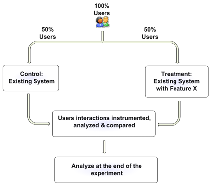

# Practical guide to controlled experiments on the web: listen to your customers not to the hippo](web03-Experiments.md)

Author: R. Kohavi, R. Henne, D. Sommerfield

Proceedings: KDD '07

Date: 2007

[Original](https://ai.stanford.edu/~ronnyk/GuideControlledExperiments.pdf)

[PPT](https://pdfs.semanticscholar.org/ee60/9ee721abea507057d30c6d0c7039e9e42da7.pdf)

## 1. Introduction

- Amazon personalized recommendation System
  - Greg Linden prototyping recommendations based on shopping cart
  - run controlled experiment $\to$ “feature won by such a wide margin that not having it live was costing Amazon a noticeable chunk of change
  - culture of experiment
    - data trumps intuition
    - a system that made running experiments easy
    - allowed Amazon to innovate quickly and effectively

- Controlled experiments
  - randomized experiments (single-factor, or fractional design)
  - A/B tests or their generalizations
  - split tests
  - control/treatment
  - parallel flights

- Simplest manifestation of the experiments on web
  - randomly assigned to one of two variants
    - Control: commonly the “existing” version
    - Treatment: usually a new version being evaluated
  - metrics
    - ranging from runtime performance to implicit and explicit user behaviors
    - Return-on-Investment (ROI)
  - survey
    - collecting data
    - conducting statistical tests
    - evaluating evaluate whether there is a statistically significant difference between the two variants on metrics of interest
  - null hypothesis: no difference between the versions
  - segmenting of users using manual (e.g., OLAP) or machine learning and data mining to understand which subpopulations show significant differences $\to$ helping improve our understanding and progress forward with an idea

- Building a system for experimentation
  - little cost of testing and experimental failure
  - encouraging innovation through experimentation

## 2. Motivating Examples

- Case 1: Checkout page at Doctor FootCare
  - conversion rate: the percentage of visit to the website that include a purchase
  - nine differences between the two variants of the Doctor FootCare checkout page
  - which one results in a higher conversion rate

- Case 2: Ratings of Microsoft Office help articles
  - initial implementation: a Yes/No widget
  - modified the widget w/ a 5-star ratings
  - motivations
    - providing finer-grained feedback
    - improving usability by exposing users to a single feedback box

- Results and ROI
  - Doctor FootCare checkout page
    - Variant A on left, Variant B on right (diagram)
    - variant A outperformed variant B by an order of magnitude
    - "upgraded" from the A to B and lost 90% of their revenue
    - coupon code: people started to think twice about whether they were paying too much
    - removing discount code from the new version (B), conversion-rate increased 6.5% relative to the old version (A)
  - Microsoft’s Office Help articles
    - the number of ratings plummeted by an order of magnitude $\to$ significantly missing on goal #2 above
    - additional tests: two-stage model actually helps in increasing the response rate
  - hard to predict the success of new designs
  - controlled experiments used heavily in backend algorithms

  <figure style="display: flex; margin: 0.5em; justify-content: center; align-items: center;">
    
  </figure>

## 3. Controlled Experiments

- Simplest controlled experiment
  - usually referred to as an A/B test
  - randomly exposed to one of two variants: control (A), or treatment (B)
  - random
    - not distributed "any old which way"
    - no factor able to influence the decision
    - Overall Evaluation Criterion (OEC) derived for each variant
  - OEC possible metrics (case 1: the conversion rate, units purchased, revenue, profit, expected lifetime value, or or some weighted combination of these
  - experiment designed and executed properly
    - the only thing consistently different between the two variants is the change between the Control and Treatment
    - any differences in the OEC are inevitably the result of this assignment, establishing causality

  <figure style="display: flex; margin: 0.5em; justify-content: center; align-items: center;">
    
  </figure>

### 3.1 Terminology

- Overall Evaluation Criterion (OEC)
  - a quantitative measure of the experiment’s objective
  - a.k.a. Response or Dependent Variable in statistics
  - other synonyms: Outcome, Evaluation metric, Performance metric, or Fitness Function (22). 
  - selecting a single metric though experiments possible w/ multiple objectives
  - possibly as a weighted combination of such objectives
  - forcing tradeoffs to be made once for multiple experiments
  - aligning the organization behind a clear objective
  - not a short-term focused (e.g., clicks)
  - including factors that predict long-term goals, e.g., predicted lifetime value and repeat visits

- Factor
  - to influence the OEC
  - assigned Values, sometimes called 
  - a.k.a. Levels or Versions, Variables
  - A/B tests: a single factor with two values - A and B.

- Variant
  - user experience being tested by assigning levels to the factors
  - either the Control or one of the Treatments
  - prefering to specifically differentiate between the Control
  - sometimes referred to as Treatment, a special variant that designates the existing version being compared against and the new Treatments being tried

- Experimentation unit
  - an entity observed, a.k.a. an item
  - assumption: independent
  - web experimentation unit
    - user: the most common experimentation unit
    - sessions or page views
    - commonly achieved through cookies

- Terminologies of statistics
  - Null Hypothesis
    - often referred to as $H_0$
    - no difference on the OECs for the variants
    - randomly observed differences during the experiment
  - Confidence level: probability of failing to reject (i.e., retaining) the null hypothesis when it is true
  - Power:
    - probability of correctly rejecting the null hypothesis, $H_0$, when it is false
    - measuring the ability to detect a difference when it indeed exists
  - Standard Deviation (Std-Dev)
    - a measure of variability
    - typically denoted by 𝜎$\sigma$
  - Standard Error (Std-Err)
    - the standard deviation of the sampling distribution of the sample statistic
    - a mean of 𝑛 independent observations: $\widehat{\sigma} / n$ where $\widehat{\sigma}$ is the estimated standard deviation.

- A/A Test
  - a.k.a. a Null Test
  - assigning users to one of two groups, but exposing them to exactly the same experience
  - scenarios
    - collecting data and assessing its variability for power calculations
    - testing the experimentation system
  - the Null hypothesis rejected about $5\%$ of the time when a $95\%$ confidence level is used

### 3.2 Hypothesis Testing and Sample Size

- Statistical test
  - used to evaluate one of the treatment is different than the Control
  - accept a Treatment as being statistically significantly different if the test rejects the null hypothesis
  - i.e., the OECs not different

- Important factors of statistical test
  - **Confidence level**
    - commonly set to 95%
    - 5% of the time incorrectly conclude that there is a difference when there is none (Type I error)
    - all else being equal, increasing this level reduces the power
  - **Power**
    - commonly desired to be around 80-95%, although not directly controlled
    - false Null Hypothesis:
      - there is a difference in the OECs
      - the power is the probability of determining that the difference is statistically significant
      - A Type II error: retaining the Null Hypothesis when it is false
  - **Standard Error**
    - the smaller the Std-Err, the more powerful the test
    - three useful ways to reduce the Std-Err
      - estimated OEC:
        - typically a mean of large samples
        - Std-Err of a mean decreasing proportionally to the square root of the sample size $\timplies$ increasing the sample size
        - usually implying running the experiment longer, reducing the Std-Err and hence increasing the power
      - using OEC components that have inherently lower variability
        - the Std-Dev, $\sigma$, smaller
        - example: conversion probability (0-100%) typically has lower Std-Dev than number of purchase units (typically small integers), which in turn has a lower Std-Dev than revenue (real-valued)
    - lower the variability of the OEC
      - filtering out users who were not exposed to the variants, yet were still included in the OEC
      - example:
        - a change to the checkout page $\to$ analyze only users who got to the page
        - everyone else adds noise, increasing the variability
  - the effect, or the difference in OECs for the variants
    - larger differences are easier to detect $\implies$ great ideas unlikely missed
    - samll effect: Type I or Type II errors more likely

- Sample size
  - the desired confidence level: $95\%$
  - the desired power: $90\%$
  - the desired sample size, $n$

    \[ n = (4r\sigma/\Delta)^2 \]

    - $r$: the number of variants (assumed to be approximately equal in size)
    - $\sigma$: the std-dev of the OEC
    - $\Delta$: the minimum difference between the OECs
    - $4$: overestimated by $25\%$ for large $n$
  - example of sample size
    - e-commerce site w/ $5\%$ of users who visit during the experiment period end up purchasing
    - purchasing spend about \$75
    - average user spending \$3.75 (95% spend \$0)
    - standard deviation: $30
    - running an A/B test and want to detect a 5% change to revenue
    - requiring over 1.6 million users to achieve the desired 90% power

      \[ 4 \cdot 2 \cdot 30 / (3.75 \cdot 0.05)^2 \ge 1,600,000\]

- Sample size with Bernoulli distribution
  - only looking for a 5% change in rate (not revenue)
  - a lower variability OEC used (Standard Error)
  - purchase, a conversion event, modeled as a Bernoulli trial with $p=0.05$ being the probability of a purchase
  - standard error of Bernoulli: $\sqrt{p(1-p)}$
  - sample size to achieve desired power: 

    \[(4 \cdot 2 \cdot \sqrt{0.05 \cdot (1 − 0.05)} / (0.05 \cdot 0.05))^2 \lt 500,000 \]

  - square factor
    - relaxed goal: detecting a 20% change in conversion
    - factor $4$ dropped by a factor of 16
    - sample size: 

    \[(4 \cdot 2 \cdot \sqrt{0.05 \cdot (1 − 0.05)} / (0.05 \cdot 0.05))^2 /16 \approx 30,400\]

- Example: lower varability of the OEC
  - change to the checkout process $\to$ only analyze users who started the checkout process
  - assumptions
    - 10% of users initiate checkout 
    - that 50% of those users complete
  - more homogenious user segment $\implies$ OEC w/ lower variability
  - average conversion rate: 0.5
  - std-dev: 0.5
  - sample size: 

    \[ (4 \cdot 2 \cdot \sqrt{0.5 \cdot (1 − 0.5)} / (0.5 \cdot 0.05))^2 = 25,600 \]

  - total number of users to the (excluding the 90% who do not initiate): 256,000

- Considerations of experiment
  - deciding in advance on the OEC (a planned comparison)
  - an increased risk of finding what appear to be significant results by chance (familywise type I error)
  - proposed adjustments
    - Fisher’s least-significantdifference
    - Bonferroni adjustment
    - Duncan’s test
    - Scheffé’s test
    - Tukey’s test
    - Dunnett’s test
  - increasing the 95% confidence level and thus reducing the statistical power

### 3.3 Extensions for Online Settings

- Extensions to basic controlled experiments in an online setting
  - treatment ramp-up
  - automation
  - software migrations

## 4. Implementation Architecture

## 5. Lesson Learned

## 6. Summary

