# Learn CSS Layout

[original](https://learnlayout.com/)


- No layout: one big column of element

- The `display` property
  - the most important property for controlling layout
  - every element w/ default display
  - most default values: **block** and **inline**
  - `block` values
    - `div`: the standard block-level element
    - starting on a *new-line* ans stretching out to the left and right as far as it could
    - example elements: `p`, `form`, `header`, `footer`, `section`, etc.
  - `inline` values
    - `span`: the standard inline element
    - wraping some text *inside* a paragraph `<span>like this</span>` w/o disrupting the flow of  the paragraph
    - most common element: `a`
  - `none` value
    - commonly used w/ JavaScript to hide and show element w/o really deleting and recreating them
    - rendering the page as though the element does not exist
    - `visibility: hidden`: hiding the element, but the element will still take up the space it would  if it was fully visible
    - always able to override default


- Centralizing elements
  - syntax: `margin: 0 auto;`

    ```css
    #main {
      margin: 0 auto;
    }
    ```

  - width of a block-level element preventing from stretching out to the edges of its container to the left and right
  - setting left and right margins to `auto` to horizontally center the element within its container
  - element taking up the width specified, then, evenly splitting the remaining space b/w two margins
  - issue: screen narrower than the width <br>
    sol: browser creating horizontal scrollbar on the page


- The `max-width` property
  - improving the browser's handling of small window
  - making a site usable on mobile
  - example: `<div id="main"> text insert here</div>

    ```css
    #main {
      max-width: 600px;
      margin: 0 auto; 
    }
    ```


- The box model
  - element's border and padding stretching out the element beyond the specified width
  - example: 

    ```css
    .simple {
      width: 500px;
      margin: 20px auto;
    }

    .fancy {
      width: 500px;
      margin: 20px auto;
      padding: 50px;
      border-width: 10px;
    }
    ```

    <div style="display: flex; justify-content: center;">
      <figure style="display: table; float: left; margin-right: 0.25em; align-items: center;">
        
      </figure>
      <figure style="display: table; float: right; margin-left: 0.25em; align-items: center;">
        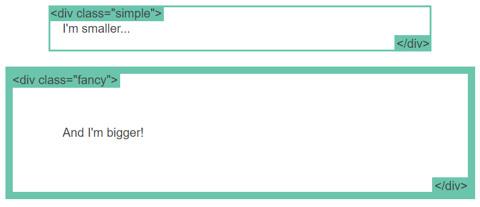
      </figure>
    </div>


- The `box-sizing` property
  - original box model behavior considered unintuitive
  - `box-sizing: border-box;`: the padding and border of the element including in the width and height of aan element
  - example

    ```css
    .simple {
      width: 500px;
      margin: 20px auto;
      -webkit-box-sizing: border-box;
        -moz-box-sizing: border-box;
              box-sizing: border-box;
    }

    .fancy {
      width: 500px;
      margin: 20px auto;
      padding: 50px;
      border: solid blue 10px;
      -webkit-box-sizing: border-box;
        -moz-box-sizing: border-box;
              box-sizing: border-box;
    }
    ```

    <figure style="display: table; margin: auto; text-align: center;"">
      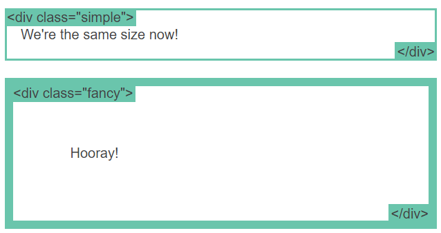
    </figure>

  - enabling all elements w/ the same box size

    ```css
    * {
      -webkit-box-sizing: border-box;
        -moz-box-sizing: border-box;
              box-sizing: border-box;
    }
    ```

  - new property:
    - using the `-webkit-` and `-moz-` prefixes for now
    - checking [browser compatibility](https://developer.mozilla.org/en-US/docs/Web/CSS/box-sizing#browser_compatibility)


- The `position` property
  - a bunch of possible values but no sense
  - `static`
    - default value
    - *not positioning* in any specific way
    - positioned: element w/ `position` set to anything else
  - `relative`
    - behaving the same as static unless you add some extra properties
    - adjusted away from its normal position: the `top`, `right`, `bottom`, and `left` properties

    <figure style="display: table; margin: auto; text-align: center;"">
      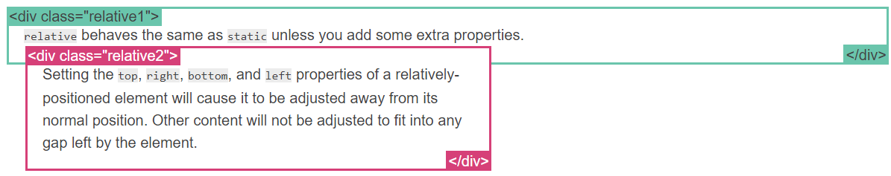
    </figure>

  - `fixed`
    - positioned relative to the *viewport*
    - stayed in the same place even if the page is scrolled
    - properties: `top`, `right`, `bottom`, and `left`
    - fixed element in the lower-right corner of the page

      ```css
      .fixed {
        position: fixed;
        bottom: 0;
        right: 0;
        width: 200px;
        background-color: white;
      }
      ```

    - not leaving a gap in the page where it normally have been located
  - `absolute`
    - the trickiest position value
    - like fixed except relative to the *nearest positioned ancestor* instead of relative to the viewport
    - no positioned ancestor $\implies$ using document body and still moving along w/ page scrolling
    - example 

      ```css
      .relative {
        position: relative;
        width: 600px;
        height: 400px;
      }
      .absolute {
        position: absolute;
        top: 120px;
        right: 0;
        width: 300px;
        height: 200px;
      }
      ```

      <figure style="display: table; margin: auto; text-align: center;"">
        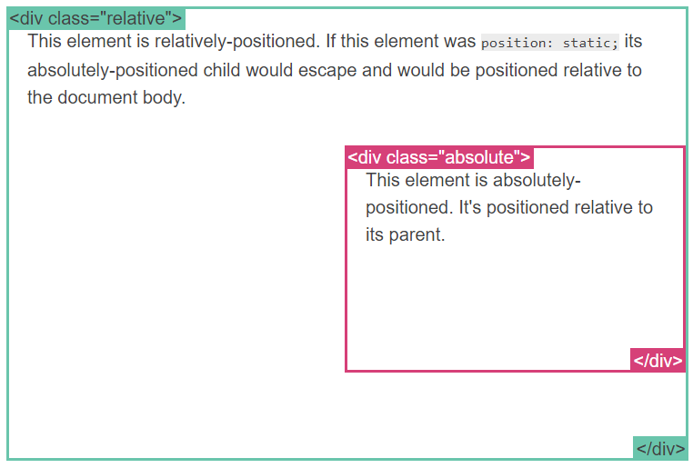
      </figure>


- Position example
  - stretching to the width of the window

  ```css
  .container {
    position: relative;
  }
  nav {
    position: absolute;
    left: 0px;
    width: 200px;
  }
  section {
    /* position is static by default */
    margin-left: 200px;
  }
  footer {
    position: fixed;
    bottom: 0;
    left: 0;
    height: 70px;
    background-color: white;
    width: 100%;
  }
  body {
    margin-bottom: 120px;
  }
  ```

  <figure style="display: table; margin: auto; text-align: center;"">
    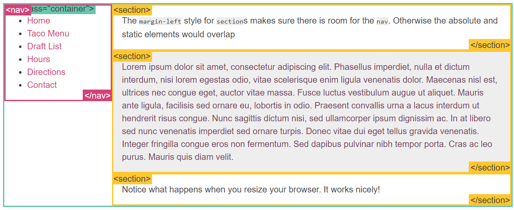
  </figure>


- The `float` property
  - intended for wrapping text around images
  - example

    ```css
    img {
      float: right;
      margin: 0 0 1em 1em;
    }
    ```

    <figure style="display: table; margin: auto; text-align: center;"">
      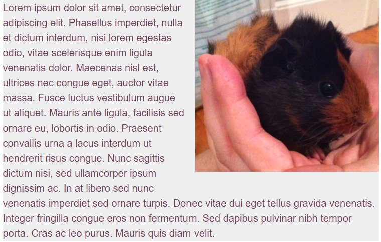
    </figure>


- The `clear` property
  - important for controlling the behavior of floats
  - example w/o `clear` (left diagram)

    ```html
    <div class="box">...</div>
    <section>...</section>
    ```

    ```css
    .box {
      float: left;
      width: 200px;
      height: 100px;
      margin: 1em;
    }
    ```

  - example w/ `clear` (right diagram)

    ```css
    .box {
      float: left;
      width: 200px;
      height: 100px;
      margin: 1em;
    }
    .after-box {
      clear: left;
    }
    ```

  <div style="display: flex; justify-content: center;">
    <figure style="display: table; float: left; margin-right: 0.25em; align-items: center;">
      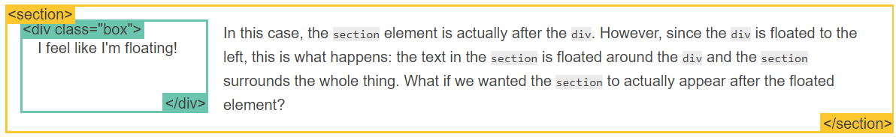
      <figcaption style="display: table-caption; caption-side: bottom; text-align: center;">
        float example w/o clear property
      </figcaption>
    </figure>
    <figure style="display: table; float: right; margin-left: 0.25em; align-items: center;">
      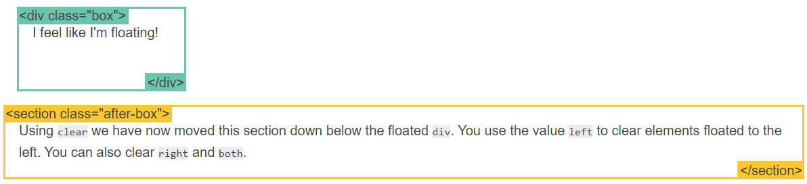
      <figcaption style="display: table-caption; caption-side: bottom; text-align: center;">
        float example w/ clear property
      </figcaption>
    </figure>
  </div>


- The `clearfix` hack
  - weird, bad thing happened w/ `float`
  - way to fixed: `clearfix`
  - example

    ```css
    /* simple float - left diagram*/
    img {
      float: right;
    }

    /* clear float after use - right diagram */
    .clearfix {
      overflow: auto;
    }
    ```

    <div style="display: flex; justify-content: center;">
      <figure style="display: table; float: left; margin-right: 0.25em; align-item: center;">
        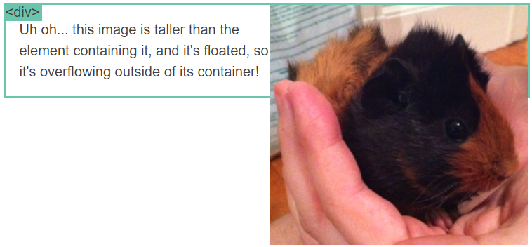
        <figcaption style="display: table-caption; caption-side: bottom; text-align: center;">
          Simple float produces weird, bad layout
        </figcaption>
      </figure>
      <figure style="display: table; float: right; margin-left: 0.25em; align-item: center;">
        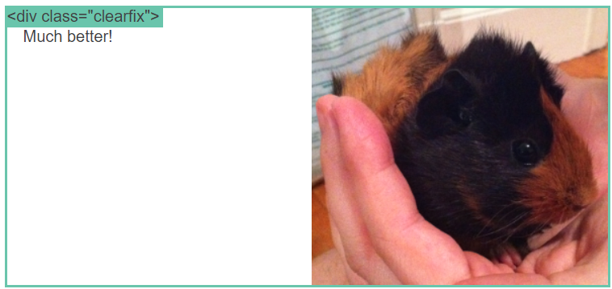
        <figcaption style="display: table-caption; caption-side: bottom; text-align: center;">
          Eliminate weird layout w/ clearfix
        </figcaption>
      </figure>
    </div>


- Float layout example
  - using `float` property than `position` property

  ```css
  nav {
    float: left;
    width: 200px;
  }
  section {
    margin-left: 200px;
  }
  ```

  <figure style="display: table; margin: auto; text-align: center;">
    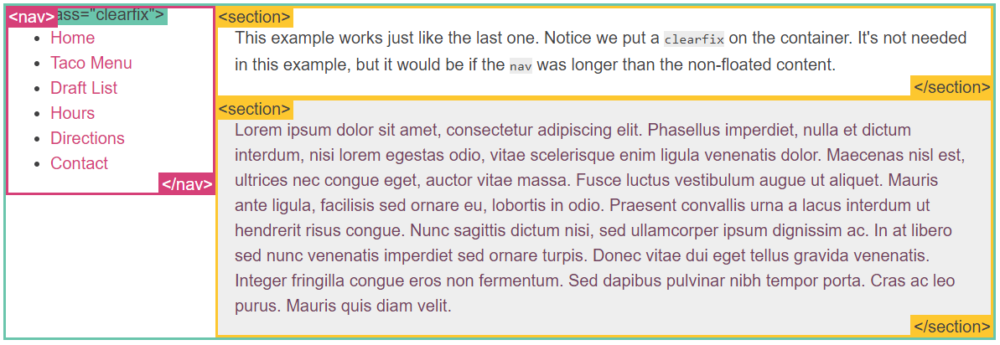
    <figcaption style="display: table-caption; caption-side: bottom; text-align: center;">
      The same layout using <code>float</code> property, not <code>position</code> property, to make things easier
    </figcaption>
  </figure>


- The percent width
  - percent: measurement unit relative to the containing block
  - great for image (left diagram)

    ```css
    article img {
      float: right;
      width: 50%;
    }
    ```

  - percent width layout (right diagram)
    - the `nav` content starting to wrap in a displeasing way when the windoe is too narrow

    ```css
    nav {
      float: left;
      width: 25%;
    }
    section {
      margin-left: 25%;
    }
    ```

    <div style="display: flex; justify-content: center;">
      <figure style="display: table; float: left; margin-right: 0.25em; align-item: center;">
        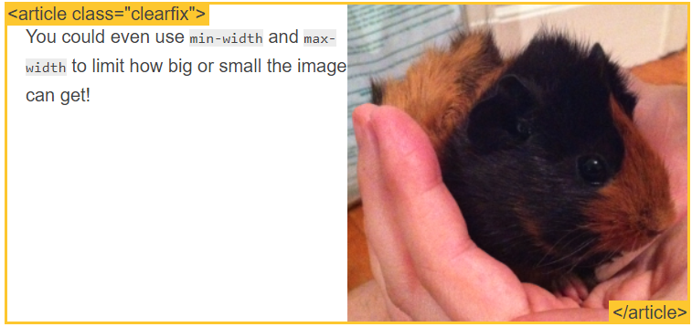
        <figcaption style="display: table-caption; caption-side: bottom; text-align: center;">
          Limiting image width w/ percentage of the container 
        </figcaption>
      </figure>
      <figure style="display: table; float: right; margin-left: 0.25em; align-item: center;">
        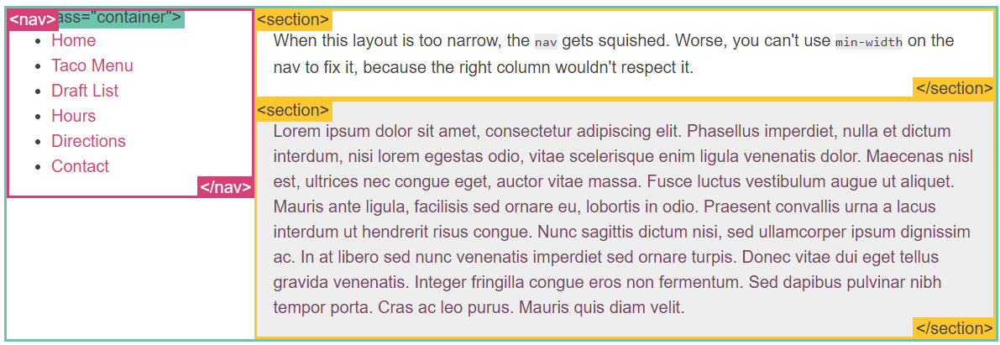
        <figcaption style="display: table-caption; caption-side: bottom; text-align: center;">
          Flexible nav bar width w/ percent width of the page layout
        </figcaption>
      </figure>
    </div>


- Media queries
  - **responsive design:**
    - the strategy of make a site that 'responds' to the browser and device
    - being shown on the browser and device by looking awesome no matter of what
  - the most powerful tool for responsive design
  - using percent width and displaying in one column when the browser too small to fit in the sidebar
  - references
    - [media queries examples](https://mediaqueri.es/)
    - [MDN web doc - Using media queries](https://developer.mozilla.org/en-US/docs/Web/CSS/Media_Queries/Using_media_queries)
    - [An Introduction to Meta Viewport and @viewport](https://dev.opera.com/articles/an-introduction-to-meta-viewport-and-viewport/)
  - example

    ```css
    @media (min-width:600px) {
      nav {
        float: left;
        width: 25%;
      }
      section {
        margin-left: 25%;
      }
    }
    @media (max-width:599px) {
      nav li {
        display: inline;
      }
    }
    ```

    <figure style="display: table; margin: auto; text-align: center;">
      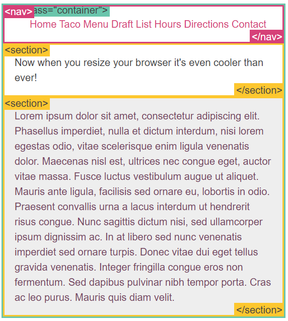
      <figcaption style="display: table-caption; caption-side: bottom; text-align: center;">
        One column layout instead of two columns when the window narrower than the nav bar size
      </figcaption>
    </figure>


- The `inline-block` attribute
  - using `float` to create a grid of boxes that fills the browser width and wraps nicely
  - `inline-block` attribute making it easier
  - similar to `inline` element but w/ width and height
  - extra work required to support IE6 & IE7
  - the hard way w/ `float` property (left diagram)

    ```css
    .box {
      float: left;
      width: 200px;
      height: 100px;
      margin: 1em;
    }
    .after-box {
      clear: left;
    }
    ```

  - the easy way w/ `inline-block` attribute (right diagram)

    ```css
    .box2 {
      display: inline-block;
      width: 200px;
      height: 100px;
      margin: 1em;
    }
    ```

  <div style="display: flex; justify-content: center;">
    <figure style="display: table; float: left; margin-right: 0.25em; align-item: center;">
      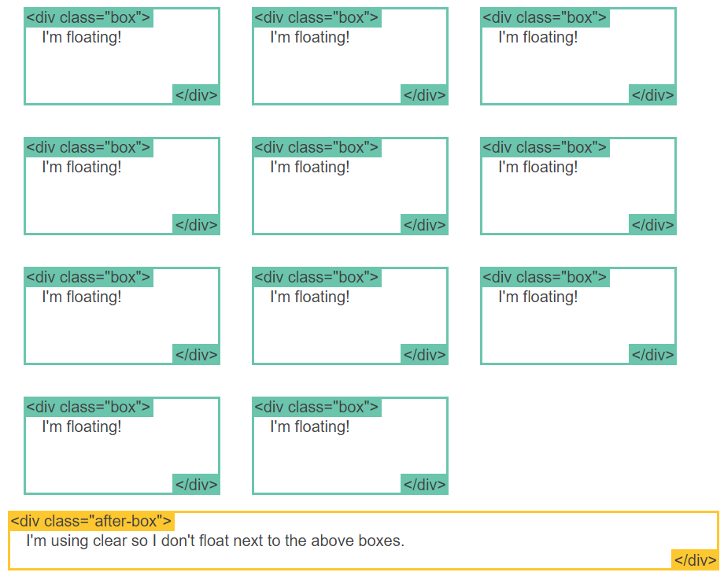
      <figcaption style="display: table-caption; caption-side: bottom; text-align: center;">
        Grid boxes using float property
      </figcaption>
    </figure>
    <figure style="display: table; float: right; margin-left: 0.25em; align-item: center;">
      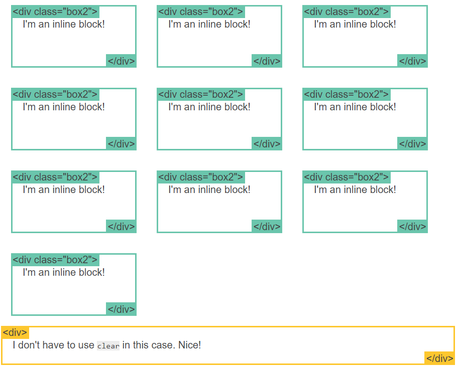
      <figcaption style="display: table-caption; caption-side: bottom; text-align: center;">
        Grid boxes using inline-block attribute
      </figcaption>
    </figure>
  </div>


